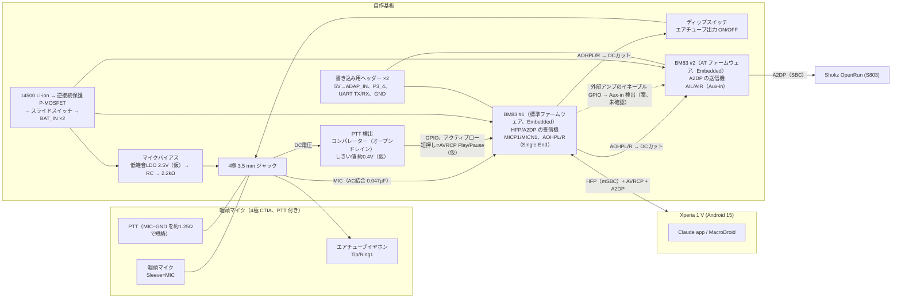

# 02 ブロック図（第1版、B1 直列中継構成）

最終更新: 2026-11-01。数値に「仮」と付いたものは、実測または資料確認の後に確定する。

## 信号の流れ

1. **話す**: 咽頭マイク → BM83#1 の ADC → DSP（HPF/AEC/NR/送話EQ）→ mSBC → スマホ → Claude。
2. **応答を聞く**: Claude → スマホ → SCO（mSBC）→ BM83#1 の DAC → アナログのライン信号 → BM83#2 の Aux-in → SBC → OpenRun。
3. **PTT**: 押すと MIC 線が約 0 V になり、コンパレーターの出力が Low になる。BM83#1 がそれをボタン入力として受け、AVRCP の Play/Pause を送る。スマホ側の MacroDroid がそれを受けて Claude を起動する。

## 動作モードごとの消費電流（仮）

| 状態 | BM83#1 | BM83#2 | その他 | 合計 |
|---|---|---|---|---|
| 待機（接続済み） | Sniff 0.55 mA | Sniff 0.55 mA | バイアス 0.3 mA | 約 1.4 mA |
| 会話中 | SCO 約 16 mA | A2DP 送信 約 12 mA | — | 約 28 mA |

出典: [DS] p.61 Table 9-12。2 段目の行は、データシートの代表値に推定分（仮）を加えた値。
